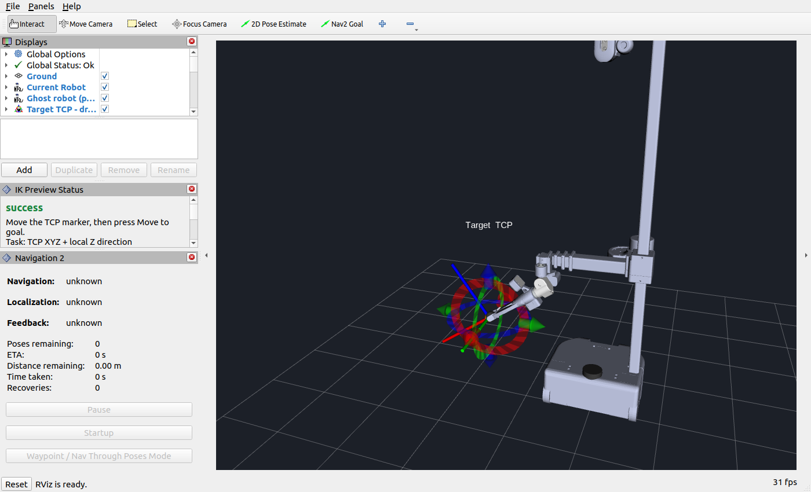
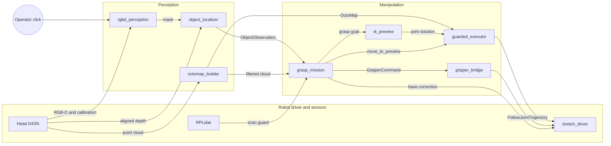
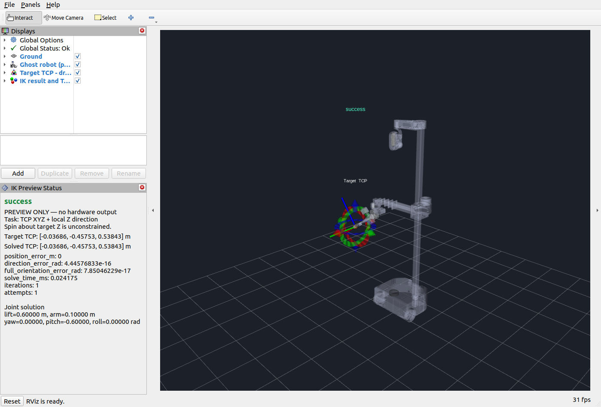
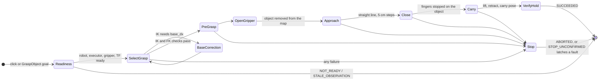

# stretch3-ik

### Overview

ROS 2 Humble packages for guarded 5-DoF manipulation and shelf grasping on the
Stretch 3 mobile manipulator. Two ways to use it:

- **One-click IK in RViz.** Drag a TCP marker, check the ghost robot, click
  **Move to goal**. The executor plans a collision-free path for the lift, arm
  and three wrist axes and runs it under guards.
- **Click-to-grasp.** Click an object in the head camera image. Depth geometry segments
  it, the depth image turns the mask into a 3D cloud, the planner picks a side
  or top-down grasp, and the mission approaches, closes, verifies and carries
  the object.

Nothing moves until it is asked to. On the real robot the launch wrapper starts
in dry run unless `dry_run:=false` is passed.

> **Note:** Independent project. Use it on real hardware at your own risk, with
> the runstop button within reach.



### Packages

| Resource | Description |
|---|---|
| [stretch\_rgbd\_perception](src/stretch_rgbd_perception/) | Geometry segmentation, persistent instances, background OCR and camera-relative object geometry |
| [stretch\_perception\_interfaces](src/stretch_perception_interfaces/) | Shared segmentation and typed object geometry messages |
| [stretch\_robot\_interface](src/stretch_robot_interface/) | Read-only robot state: URDF model, joint decoding, freshness and homed/runstop flags |
| [stretch\_custom\_kinematics](src/stretch_custom_kinematics/) | URDF-derived FK, 5-DoF IK (marker and grasp goals), isolated RViz IK preview and status panel |
| [stretch\_collision\_planning](src/stretch_collision_planning/) | OctoMap and primitive scenes, capsule arm model, RRT-Connect, `octomap_builder` with robot self-filter |
| [stretch\_guarded\_executor](src/stretch_guarded_executor/) | The only node that commands the arm: planning, timing, guards, dynamic obstacle stop, dry run |
| [stretch\_custom\_manipulation](src/stretch_custom_manipulation/) | Bringup (`sim:=true/false`), grasp mission, perception nodes, gripper bridge, configs, RViz layout |
| [stretch\_lift\_rviz\_control](src/stretch_lift_rviz_control/) | Legacy lift-only RViz marker and panel used for commissioning |

`stretch_robot_interface` and `stretch_custom_kinematics` never command
hardware. Arm trajectories only leave through `stretch_guarded_executor`; the
grasp mission adds gripper, head and small base-correction commands.

### How it fits together



The same `ik_preview` and `guarded_executor` serve the RViz marker. Perception
continuously detects and tracks objects; a click selects a mask for localization
and the grasp mission. The RViz marker remains independently available.

### Requirements

- Ubuntu 22.04 with [ROS 2 Humble](https://docs.ros.org/en/humble/Installation.html)
- `ros-humble-octomap`, `ros-humble-octomap-msgs`, Nav2 (`rosdep` installs them)
- For the real robot: a Stretch 3 with its ROS 2 driver workspace in `~/ament_ws`, reachable on ROS domain 42
- For perception/grasping: run `scripts/install_perception.sh` (Open3D, OpenCV, SciPy and background RapidOCR; no SAM or Torch)
- Optional: `pip3 install hello-robot-stretch-urdf` to show robot meshes in RViz (FK and IK do not need them)

### Installation

The repository is itself a colcon workspace:

```bash
git clone https://github.com/JLUAS/stretch3-ik.git ~/stretch3-ik
cd ~/stretch3-ik
source /opt/ros/humble/setup.bash
rosdep install --from-paths src --ignore-src -r -y
colcon build --symlink-install --cmake-args -DCMAKE_BUILD_TYPE=RelWithDebInfo
```

`-r` lets rosdep skip keys it cannot resolve (`stretch_core`,
`stretch_nav2`, `stretch_small_house_sim`); the kinematic simulation and the
tests do not need them. Use a fresh terminal to avoid unrelated workspace
overlays.

On the robot, the packages live next to the driver in `~/ament_ws/src`.
[`scripts/deploy_to_robot.sh`](scripts/deploy_to_robot.sh) copies them there,
replacing only this repository's packages, and builds them.

### One-click IK in RViz

#### Simulation

```bash
cd ~/stretch3-ik
./src/stretch_custom_manipulation/scripts/run_manipulation.sh sim:=true scenario:=fixture
```

The wrapper picks domain 20 and localhost-only DDS for simulation (domain 42
for the robot), stops a stale ROS daemon, sources ROS and the workspace and
starts the unified bringup.

`scenario:=fixture` is a **kinematic** simulation: trajectories, feedback and
cancellation against a primitive desk scene, no dynamics or contacts. Without
`scenario`, `sim:=true` selects `small_house`, a Gazebo world that needs a
separate simulation workspace (`STRETCH_SMALL_HOUSE_WS`).

#### Real robot

The robot must be homed with the runstop released; this workspace does not
home or release the runstop. The bringup starts the driver, cameras, lidar,
Nav2 and RViz. Inspection without motion:

```bash
cd ~/ament_ws
./src/stretch_custom_manipulation/scripts/run_manipulation.sh sim:=false dry_run:=true
```

Stop that process completely, then enable physical execution explicitly:

```bash
./src/stretch_custom_manipulation/scripts/run_manipulation.sh sim:=false dry_run:=false
```

See the [real robot quickstart](src/stretch_custom_manipulation/docs/REAL_ROBOT_QUICKSTART.md)
and the [commissioning checklist](src/stretch_custom_manipulation/docs/REAL_ROBOT_TEST_CHECKLIST.md)
before the first physical run.

#### Usage



Move and orient the `target_tcp` marker until the panel reports `success`,
then click **Move to goal** once. The executor switches to trajectory mode if
needed, plans around the collision scene and executes. **DISARM / STOP**
cancels the motion. Dragging the marker never moves the robot, clicks are
rejected while a motion runs, and an unreachable goal never executes the
previous ghost.

### Click-to-grasp (real robot)



1. Map the spot once (`scripts/grasping_quickmap.sh`), then start the bringup
   with `scripts/grasping_dryrun.sh` (no motion) or `scripts/grasping_run.sh`.
2. Park the robot with the object on its right, 0.55 to 0.9 m from the base
   center.
3. Click the object in `rqt_image_view` on `/camera/color/image_raw`. With
   `auto_start` (default) a click starts the mission once a collision-free
   grasp is planned.
4. Follow `/grasp_mission/status` (stages) or `/grasp_mission/events` (JSON
   lines). `/grasp_mission/stop` stops arm, base and mission;
   `/grasp_mission/release` opens the gripper.

Every mission ends exactly once: `SUCCEEDED` only when the fingers stopped on
the object after the carry, otherwise `ABORTED` with an error code and the
failed stage. Any failure after motion started stops the executor and waits
for the stop to be confirmed. The full runbook, parameters and known limits
are in [GRASPING.md](src/stretch_custom_manipulation/docs/GRASPING.md); the
segmentation contract is in
[SEGMENTATION\_INTERFACE.md](src/stretch_custom_manipulation/docs/SEGMENTATION_INTERFACE.md).

### Testing

Run every unit, transport and launch test in a private network namespace,
where the robot is unreachable:

```bash
cd ~/stretch3-ik
source /opt/ros/humble/setup.bash
colcon build --symlink-install
./scripts/sim_isolated.sh bash -c 'colcon test && colcon test-result --verbose'
```

`sim_isolated.sh` refuses to run if it can see a non-loopback interface, a
route to the robot or a shared `/dev/shm`. The suite covers FK/IK, guards,
collision checking and RRT, the grasp planner, the mission state machine
against a mock driver, the perception chain and the one-click bringup (five
axes, double click, unreachable goal, STOP). Unit tests use captured URDF
fixtures; the runtime always reads the live `/robot_description`.

Seeded grasp trials against the real executor, IK and gripper bridge, with a
mock driver and mock perception:

```bash
./scripts/sim_isolated.sh $PWD/src/stretch_custom_manipulation/test/sim/run_sim.sh \
  /tmp/grasp_trials $PWD/src/stretch_custom_manipulation/scripts/grasp_mission.py 10 --auto
```

Each trial ends with the mission's final status (`DONE: object held at ...`);
per-trial details go to `/tmp/grasp_trials/trials.jsonl`.

### Components and earlier milestones

- [Guarded executor](docs/GUARDED_EXECUTOR.md): implementation, test evidence and the manual 1 cm lift procedure. The commissioning launch defaults to DISARMED, dry run, execution disabled.
- [IK and preview](docs/IK_AND_PREVIEW.md) and [measured results](docs/IK_VALIDATION_RESULTS.md): 1,000 random FK, IK, FK round trips and preview validation on domains 20 and 42.
- [ROS interface contract](docs/ROS_INTERFACE_CONTRACT.md), [kinematic model](docs/KINEMATIC_MODEL.md), [simulation/real architecture](docs/SIM_TO_REAL_ARCHITECTURE.md)
- [Architecture](src/stretch_custom_manipulation/docs/ARCHITECTURE.md), [gripper contract](src/stretch_custom_manipulation/docs/GRIPPER_CONTRACT.md)
- [Design history](docs/history/): the grasping plan, the reliability audit and the changes it led to

Read-only validators, for checking a robot or a simulator against the
interface contract (domain 42 for the robot, 20 for simulation):

```bash
source install/setup.bash
source scripts/use_real.sh
ros2 run stretch_robot_interface interface_validator
ros2 run stretch_custom_kinematics fk_validator
```

Both only read; Ctrl-C stops them. The strict FK comparison and its
parameters are in the [kinematic model](docs/KINEMATIC_MODEL.md). No credentials are required by, or
stored in, this workspace.

### Licenses

For license details for this repository, see [LICENSE](LICENSE) and
[THIRD\_PARTY\_LICENSES.md](THIRD_PARTY_LICENSES.md). A summary of the licenses follows:

| Resource | License |
|---|---|
| All packages, scripts and documentation | [Apache 2.0](http://www.apache.org/licenses/LICENSE-2.0) |
| Captured robot URDF files (`*.urdf`) | [BSD 3-Clause Clear License](https://choosealicense.com/licenses/bsd-3-clause-clear/), see [THIRD\_PARTY\_LICENSES.md](THIRD_PARTY_LICENSES.md) |
